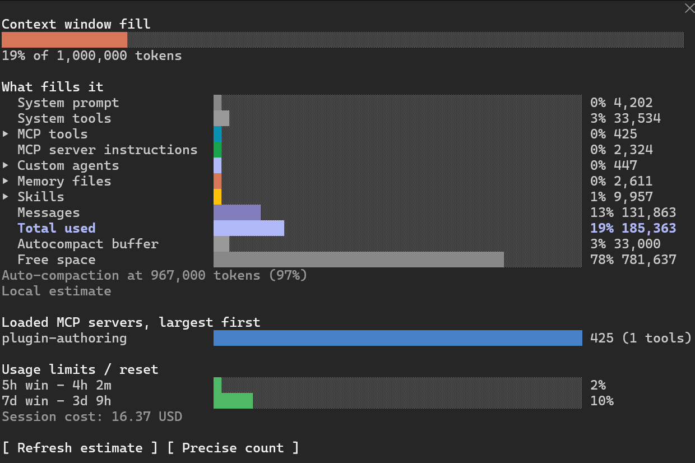

# context-panel

A side panel for Claude Code that shows what fills the context window, how much of the usage limits is used, and what the session costs.



## What the panel shows

**Context window fill.** A bar and the share of the window in use, for example `15% of 1,000,000 tokens`. The number comes from Claude Code's reading after the last response.

**What fills it.** One row per category of the context window, as Claude Code's `/context` command lists them: system prompt, system tools, MCP tools, MCP server instructions, custom agents, memory files, skills, messages. After the rows that occupy the window comes **Total used**, their sum. Then come the autocompact buffer and the free space. Deferred tool schemas are not shown, because they are not in the window until a tool is loaded. Below the rows the panel shows the threshold for automatic compaction.

**Rows that open.** Four rows open to show what they contain:

- **Skills**: every skill in the list Claude receives at each session, with the tokens of its description and where it comes from (`yours`, `built-in`, `project`, `from your account` for skills synced from claude.ai, `plugin <name>`, `from an MCP server`). At the top, under **Loaded this session**, the skills whose full text was loaded in this session, with an estimate of its tokens and how many times it was loaded.
- **MCP tools**: the MCP servers whose tools are loaded, with tokens and number of tools.
- **Memory files**: the CLAUDE.md and memory files, with tokens.
- **Custom agents**: the agent definitions, with tokens.

**Loaded MCP servers, largest first.** When MCP tools are loaded in the window, up to six servers with their tokens and number of tools.

**Usage limits / reset.** The 5-hour window (`5h win`) and the 7-day window (`7d win`), each with the time left to its reset beside the name and the share used after the bar, for example `5h win - 4h 33m` and `7d win - 2d 14h`. Below them, the session cost in USD, when Claude Code reports one.

## Install

At the prompt of a Claude Code terminal session:

```
/plugin install context-panel --marketplace paolodalprato/mod-claude-code
```

Answer `y` to add the marketplace, then choose a scope (the user scope is first; press Enter).

From a shell:

```
claude plugin install context-panel --marketplace paolodalprato/mod-claude-code
```

In the Claude Desktop app, where `/plugin` does not run: click + next to the prompt box, then Plugins, Add marketplace with `paolodalprato/mod-claude-code`, then Add plugin. A mod installed from a terminal at the user scope also loads in the Code tab of the desktop app.

## Use

Type `/context-panel` to open the panel. When it opens, the panel takes a local estimate of the categories.

When the panel has focus:

- `s` (**Refresh estimate**) takes a new local estimate and reads the loaded skills again. It is free.
- `p` (**Precise count**) asks the API to count the tokens of each category, as `/context` does. It is more accurate and sends token-count requests.

A row with ▸ opens with a click and closes with a second click. Clicks work in fullscreen mode (`"tui": "fullscreen"` in settings). Without the mouse, move the focus to the panel with `ctrl+x` then `Tab`, move between rows with `Tab` and open a row with `Enter`.

## Which numbers are estimates

- The fill at the top is Claude Code's reading after the last response. The categories are a separate measurement, taken when you open the panel or press `s` or `p`. That is why the two totals can differ by a few hundred tokens. The note under the categories says which measurement it is (`Local estimate` or `Precise count`) and adds `the context has changed since` when the fill has changed after it.
- The skill tokens in the Skills list count only the description, the part Claude receives at every session. The full text of a skill enters the window only when the skill is used.
- The tokens of the skills under **Loaded this session** are an estimate at 3 characters per token, computed from the text in the conversation. Claude Code counts that text in **Messages**, so the panel does not add it to the Skills row. A skill loaded twice is in the window twice and is shown as `loaded 2 times`. Reference files that a skill reads with a tool are counted in Messages and are not attributed to the skill. After a compaction the list is empty.
- The panel recognises the rows that open by their names (`skill`, `mcp tool`, `memory`, `agent`). If a future version of Claude Code renames a category, that row stays plain.
- The cost in USD is the figure Claude Code reports for the session. With a subscription it may not match what you pay.

## Requirements

- Claude Code with the hooks module API. Tested on version 2.1.304. The API is in early access and can change between releases.
- Tested in the terminal. In the Code tab of Claude Desktop it is expected to work, but it has not been tried.

## Files

- `hooks/register.tsx`: the hooks module.
- `types/index.d.ts`: the type contract for the panel's state.
- `tests/context-panel.test.tsx`: tests, run with `claude plugin test context-panel`.

## License

[MIT](../LICENSE)
